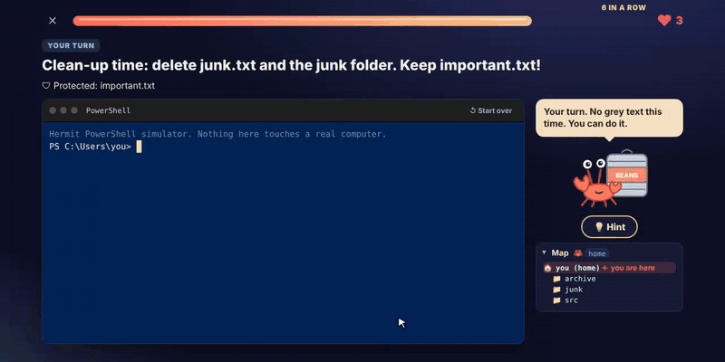

# Hermit: Hackyard Yard #7 submission

Theme: **Remix**

- **Play it:** https://hermit-shell.vercel.app
- **Repo:** https://github.com/Robertg761/hermit
- **Demo video (41 seconds, narrated):** [`docs/demo.mp4`](docs/demo.mp4)
- **Builder:** Robert ([@Robertg761](https://github.com/Robertg761)), solo

## The remix

**The original:** the bite-sized language-learning app. Short lessons, hearts, XP, a streak, a winding path of units, and a mascot with opinions.

**The twist:** the language is your computer's own shell. You pick Linux, macOS or Windows, and every lesson teaches that system's real commands in a simulated terminal: Bash, zsh or PowerShell. When you type a habit from another system, such as `rm -rf` in PowerShell, you get the real error and then Herme the hermit crab explains the difference.

The core is kept: learn a little, practise right away, never get tested on something you were not taught, and come back tomorrow. The one big change is what you are learning, and that it is typed into a real-feeling terminal instead of tapped.

## Try it in two minutes

1. Open the site and pick an operating system. You are typing your first command about fifteen seconds later.
2. Finish "Hello, terminal". It takes about two minutes.
3. Type something from the wrong system. In PowerShell try `ls -la` or `sudo ls`. In Bash try `dir` or `Get-ChildItem`.
4. Poke at it. `export`, `man`, `vim`, `git` and friends explain themselves and never cost a heart. There are 8 easter eggs.
5. Know the basics already? Each unit has a "Skip ahead" link.

## What is in it

- 5 units, 18 lessons and 184 steps, each written for all three systems.
- Three simulated shells with each one's real output, error wording and exit codes. Nothing you type is executed.
- Lessons built on a written teaching method ([`docs/PEDAGOGY.md`](docs/PEDAGOGY.md)): a Learn card, then type along, pick, match, build from tiles, and finally do it yourself. A test in the repo fails if a lesson uses a command it has not taught.
- Steps are checked by what happened, not by what you typed, so any command that does the job passes.
- Help that fits beginners: a folder map that shows where you are, plain-English readings of error messages, Tab completion, a hint when you are stuck even if you made no mistake, and a "Start over" button that puts the files back.
- A recap after every lesson with how to open a real terminal on your system and what to try there, and a cheat sheet per unit.
- Hearts, XP, streaks, and a new shell for Herme with every unit you finish.
- It works on a phone, with a key bar for the symbols a phone keyboard hides.

## How it was built

Vite, React and strict TypeScript, with xterm.js for the terminal, deployed on Vercel. The whole app runs in the browser. There is no server code, no account and no API key. Progress is kept in the browser's local storage.

Each shell is a small interpreter (a parser plus command handlers) over an immutable in-memory filesystem, in pure TypeScript under `src/domain/`. Lesson goals are declarative checks on the resulting state. 891 tests cover the filesystem, the three shells, the lesson engine and every lesson: a golden test proves each step is solvable on each system, and that it is not already solved before you start.

What is and is not simulated is listed in [`SIMPLIFICATIONS.md`](SIMPLIFICATIONS.md). The original plan is in [`SPEC.md`](SPEC.md).

## Build week

All code, lesson content, art and sound were made during build week, starting Monday November 16, 2026. The build was done with AI assistance (Claude Code). Herme, the shells and every other drawing are original SVG written for this project, and the sounds are synthesized in the browser. No code, art, music or names were copied from any existing app.

## Cut from the plan

Rosetta mode ("I know Linux, teach me PowerShell") and AI-written hints were the first two items on the spec's cut list, and both were cut so the time could go into teaching quality. Units 6 to 8 are shown on the path as "Coming next".
